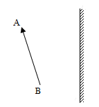

# Physics - 题目 703

**ID**: ae6ae6d6863a4f31b33d283ba5c83518
**年级**: Grade 8
**难度**: Easy
**题型**: Drawing

## 题目
请在图中作出物体AB在平面镜中的像（请保留作图痕迹）。​​​​​​​‌

## 解答

1. 

## 知识点

**中文**:
  - 平面镜成像的相关作图

**English**:
  - Drawing Plane Mirror Ray Diagrams

---
