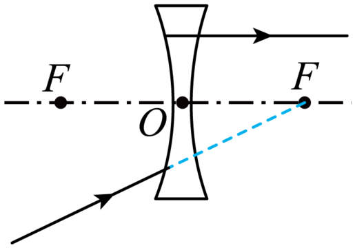

# Physics - 题目 1737

**ID**: d5209bcf83794c0b9775b2c6058d341d
**年级**: Grade 8
**难度**: Easy
**题型**: Drawing

## 题目
完成如图所示的光路图。​​​​​​​‌

## 解答

1. 凹透镜对光线有发散作用，根据凹透镜三条特殊光线的画法，延长线过焦点的光线经凹透镜折射会平行于主光轴，如图所示
2. 

## 知识点

**中文**:
  - 作透镜的光路图

**English**:
  - Drawing Ray Diagrams for Lenses

---
