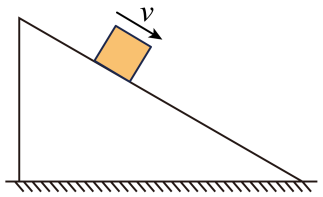

# Physics - 题目 1252

**ID**: de353d1e0f6e4c859ddc30a3c6d0b4ca
**年级**: Grade 8
**难度**: Easy
**题型**: Drawing

## 题目
如图的木块正在沿斜面下滑，画出它受到的重力和斜面对它的摩擦力的示意图。​​​​​​​‌（      ）

## 解答

1. 过木块的重心，沿竖直向下的方向画一条有向线段，用G表示，即为重力的示意图，木块还受到平行于斜面向上的滑动摩擦力，过木块的重心，沿平行于斜面向上的方向画一条有向线段用f表示，即为摩擦力的示意图.如图所示
2. 
3. 【点睛】在斜面上物体受竖直向下的重力，平行于斜面向上的滑动摩擦力。

## 知识点

**中文**:
  - 摩擦力的示意图
  - 重力示意图

**English**:
  - Friction Force Diagrams
  - Gravity Diagrams

---
