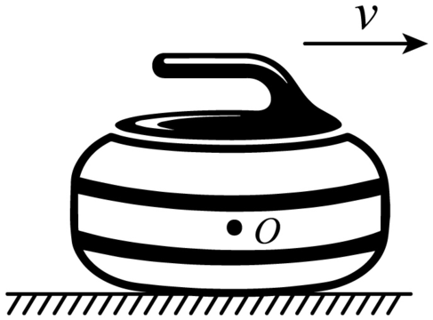

# Physics - 题目 1716

**ID**: dfd0122b352543d5bbe70c1d172774c0
**年级**: Grade 8
**难度**: Easy
**题型**: Drawing

## 题目
如图所示是冰壶脱手后在水平冰面上向右运动的情景，请面出冰壶受力示意图。​​​​​​​‌（O点为力的作用点）

## 解答

1. 冰壶正在水平向右运动，冰壶在竖直方向上受力平衡，竖直向下的重力和地面对其竖直向上的支持力是一对平衡力，大小相等， 在水平方向，被推出去的冰壶由于惯性继续向前运动，因此只受到水平向左的摩擦力，如图所示：
2. 

## 知识点

**中文**:
  - 摩擦力、平衡力和非平衡力作图

**English**:
  - Drawing Friction, Equilibrium, and Non-Equilibrium Forces

---
