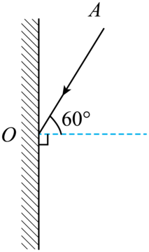

# Physics - 题目 1997

**ID**: ecb4212a6f414b62a5e85f924b2e7beb
**年级**: Grade 8
**难度**: Easy
**题型**: Drawing

## 题目
画出下图中入射光线AO的反射光线并标出反射角的大小。​​​​​​​‌

## 解答

1. 已知入射光线AO和入射角为 $60{}^\circ $ ，过O点作镜面的垂线，图中的虚线，过O点在虚线的下方作反射光线OB，并标上箭头，且使反射光线与虚线的夹角为 $60{}^\circ $ ，则入射光线AO的反射光线为OB，如图所示：
2. 

## 知识点

**中文**:
  - 作光的反射光路图

**English**:
  - Drawing Reflection Ray Diagrams

---
