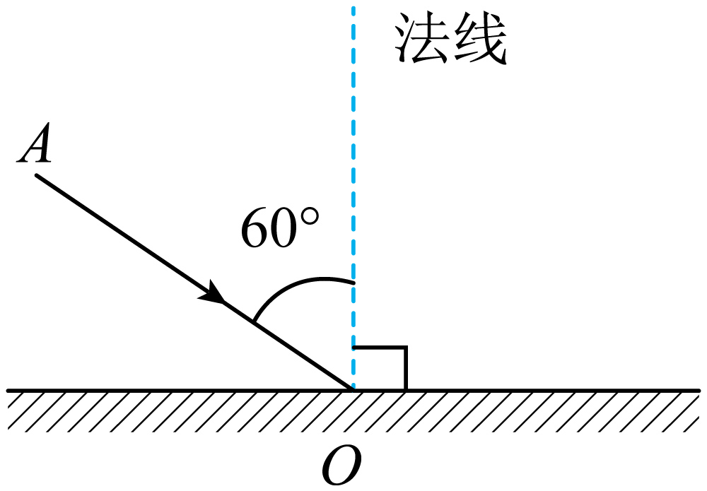

# Physics - 题目 2789

**ID**: f24891fd47e84021847cefabf227b2c7
**年级**: Grade 8
**难度**: Easy
**题型**: Drawing

## 题目
在如图中，根据给出的入射光线AO画出反射光线OB，并标出反射角的度数。​​​​​​​‌

## 解答

1. 过入射点O作法线，根据反射角等于入射角，在法线右侧画出反射光线，反射光线与法线之间的夹角为反射角，度数等于入射角为 $60{}\degree $ ，如下图所示：
2. 

## 知识点

**中文**:
  - 作光的反射光路图

**English**:
  - Drawing Reflection Ray Diagrams

---
