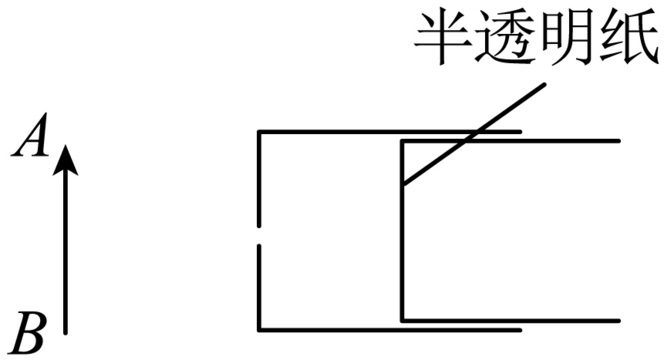

# Physics - 题目 2271

**ID**: fd4d31561d18419bbd184dc695efab42
**年级**: Grade 8
**难度**: Easy
**题型**: Drawing

## 题目
在图中作出蜡烛AB通过小孔在半透明纸上的像A'B'。​​​​​​​‌

## 解答

1. 从A、B两点通过小孔沿直线作出端点A、B的像点A′、B′，连接A′、B′即为蜡烛AB的像，如图所示：
2. 

## 知识点

**中文**:
  - 光沿直线传播的应用

**English**:
  - Applications of Rectilinear Propagation

---
