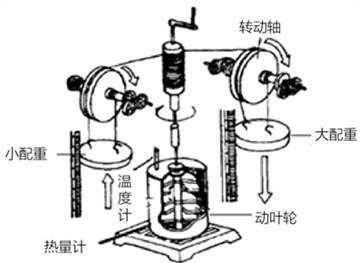
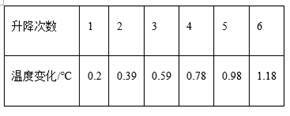

# Physics - 题目 227

**ID**: 57c5408c2a91461aa6e2da1df4ed3974
**年级**: Grade 8
**难度**: Easy
**题型**: Experiment

## 题目
如图所示，这是一个著名物理学家发现一个伟大定律的实验装置！仔细观察后回答：（1）如图，装置中的两个配重重力不等，释放后大配重下降，小配重上升；​​​​​​​‌通过反复对调左右两个配重，会使动叶轮不停地转动，从而导致热量计中水的温度（填变化情况），原因是，实现的能量转化是：．（2）科学家某次实验测得数据如下：小配重重力G_{小}=100N．大配重重力G_{大}=520N，每升降一次配重各自移动的距离h=1m，热量计中水的质量m=500g，升降次数与水温变化的关系如下表所示：通过分析数据（只需分析一次实验），叶轮对水做功J，水吸收热量J，科学家得出了结论：在上述现象中能量是的！本实验误差主要来源于克服摩擦做功消耗一部分能量．这个著名物理学家叫焦耳！这个伟大的定律叫能量守恒！刚才你所经历的正是这个伟大工作的一个缩影．由此可以看出实验结论是建立在大量的实验的基础上．

## 解答

1. （1）通过反复对调左右两个配重，会使动叶轮不停地转动，从而导致热量计中水的温度升高；这是因为对水做功，水的内能增加；能量的转化为机械能转化为内能．
2. （2）小配重重力G_{小}=100N，大配重重力G_{大}=520N，合力为420N，每升降一次配重各自移动的距离h=1m，即绳子一端移动的距离是1m，叶轮对水做的功（消耗的机械能）：W=G•h=420N×1m=420J；由表格知，升降一次水温升高0.2℃，水吸收的热量（增加的内能）：Q_{吸}=cm△t=4.2×10^{3}J/（kg•℃）×0.5kg×0.2℃=420J；所以，W=Q_{吸}，即可得出了结论：在上述现象中能量是守恒的．

## 知识点

**中文**:
  - 能量的转化

**English**:
  - Transformation of Energy

---
