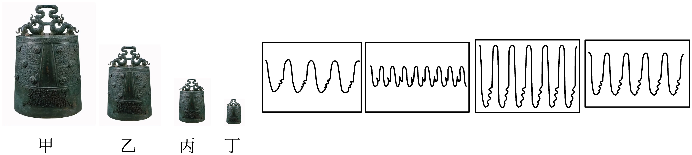

# Physics - 题目 333

**ID**: 0e7f948bba8e4a449f66b19b27179dd8
**年级**: Grade 8
**难度**: Easy
**题型**: Fill-in-the-blank

## 题目
编钟是我国出土的春秋战国时代的乐器，声音悦耳动听。​​​​​​​‌现有四个编钟，如图所示，其中有一编钟上有一隐形的裂痕，为了查找出这口编钟，用锤子分别敲击它们，将所产生的声波输入示波器中，四幅图为示波器中显示的对应的波形图，则敲编钟用力最大，编钟有裂痕。人们利用软件对正常录制的编钟音频处理后，再以3倍的速度快速播放，此时声波的频率也为正常声音的3倍，则处理后声音的改变，传播速度。（填“变大”“变小”或“不变”）

## 解答

1. 由右边的四个波形图知道，振动最快的是第2幅图，振动最慢的是第1幅图；振动由快到慢的顺序为第2幅图、第3幅图、第4幅图、第1幅图；编钟的质量越大，其振动越慢；编钟的质量越小，其振动越快；结合前面分析和编钟的大小知道，第2幅图与丁编钟对应，第3幅图与丙编钟对应，第4幅图与乙编钟对应，第1幅图与甲编钟对应；从波形图知道，振幅最大的是丙编钟，因此敲丙编钟用力最大。
2. 当编钟上有一隐形的裂痕时，其音色会与其他编钟不同，其波形图也会有所不同；结合上面的波形图知道，丁编钟的波形图在形状上不同于其他编钟，因此丁编钟有裂痕。
3. 播放速度变为原来的3倍时，播出声波的频率变为原来3倍，所以处理后声音的音调比正常声音的音调高。
4. 声音的传播速度与介质的种类和温度有关，与声音的频率无关，所以处理后声音的传播速度不变。

## 知识点

**中文**:
  - 区分音调、响度与音色
  - 用波形比较频率

**English**:
  - Distinguishing Pitch, Loudness, and Timbre
  - Comparing Frequency using Waveforms

---
