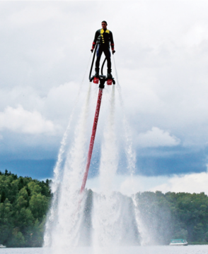

# Physics - 题目 202

**ID**: 105e939e4af8469eb3572aef210a4636
**年级**: Grade 8
**难度**: Easy
**题型**: Fill-in-the-blank

## 题目
如图所示是某同学外出游玩时看到的水上飞行娱乐项目，飞行器下的喷水装置向下喷水使人升空，这是利用了，水流喷出的速度、大小和方向在不断改变，从而改变人的，使人们感受此项运动的刺激。​​​​​​​‌

## 解答

1. 当飞行器下的喷水装置向下喷水时，水受到向下的作用力被喷出，同时水会给飞行器及人一个向上的反作用力，使人升空，这体现了力的作用是相互的。
2. 通过改变水流喷出的速度、大小和方向，能改变人受到的向上的力的大小和方向，从而改变人的运动状态，如上升、下降、前进、转向以及在空中做出各种动作等。

## 知识点

**中文**:
  - 力的作用效果
  - 力的作用是相互的

**English**:
  - Effects of Force
  - Interaction of Forces

---
