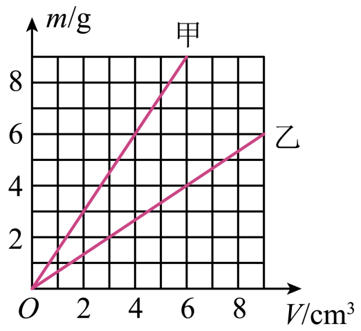

# Physics - 题目 776

**ID**: 239f4f17cd5f4635b5e364d5860c8843
**年级**: Grade 8
**难度**: Easy
**题型**: Fill-in-the-blank

## 题目
如图是甲、乙两种不同物质的质量和体积的关系图像。​​​​​​​‌甲物质的密度ρ_{甲}为g/cm^{3}，ρ_{甲}ρ_{乙}（选填“＝”“＞”或“＜”）。分别用甲、乙两种物质做成体积相同的实心体，则它们的质量之比m_{甲}∶m_{乙}为。

## 解答

1. 由图可知，当甲物质的体积为4cm^{3}时，质量为6g，则甲物质的密度为 $ρ{{}_{甲}}=\frac {m{{}_{甲}}}{V{{}_{甲}}}=\frac {6{\rm{g}}}{4{\rm{c}}{\rm{m}}{^{3}}}=1.5{\rm{g}}{\rm{/}}{\rm{c}}{\rm{m}}{^{3}}$ ，由图可知，当乙物质的体积为6cm^{3}时，质量为4g，则乙物质的密度为 $ρ{{}_{乙}}=\frac {m{{}_{乙}}}{V{{}_{乙}}}=\frac {4{\rm{g}}}{6{\rm{c}}{\rm{m}}{^{3}}}=\frac {2}{3}{\rm{g}}{\rm{/}}{\rm{c}}{\rm{m}}{^{3}}$ ，所以甲物质的密度大于乙物质的密度，即ρ_{甲}＞ρ_{乙}。分别用甲、乙两种物质做成体积相同的实心体，则它们的质量之比 $m{{}_{甲}}∶m{{}_{乙}}=ρ{{}_{甲}}V∶ρ{{}_{乙}}V=ρ{{}_{甲}}∶ρ{{}_{乙}}=1.5{\rm{g}}{\rm{/}}{\rm{c}}{\rm{m}}{^{3}}∶\frac {2}{3}{\rm{g}}{\rm{/}}{\rm{c}}{\rm{m}}{^{3}}=9∶4$ 。

## 知识点

**中文**:
  - 密度公式的应用

**English**:
  - Application of Density Formula

---
