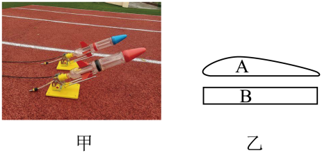

# Physics - 题目 2476

**ID**: 2c949d66f5e348fa9c7fe1f6984e8b63
**年级**: Grade 8
**难度**: Easy
**题型**: Fill-in-the-blank

## 题目
2024年5月双流区某学校举行了以“问天”为主题的科技制作大赛。​​​​​​​‌如图甲是小刚用饮料瓶制作的“水火箭”，向瓶内打气，当瓶内气压增大到一定程度时，“水火箭”向下喷水从而获得升空的动力，这利用了物体间力的作用是的，小明制作了一款滑翔机模型，机翼的横截面应设计成图乙中的形状。

## 解答

1. 水火箭升空利用的是“反冲力”，即高压气体将水向下喷射出去，对水施加一个向下的力，物体间的力都是相互的，水对火箭施加一个向上的力，火箭就升空了。
2. 飞机获得升力靠飞机机翼上凸下平的形状，使得机翼上面流速大，压强小，下方流速慢，压强大，从而产生一个向上的压力差，使得飞机飞起来，故应选择A形状。

## 知识点

**中文**:
  - 力的作用是相互的
  - 流体压强与流速的关系

**English**:
  - Interaction of Forces
  - Relationship between Fluid Pressure and Flow Speed

---
