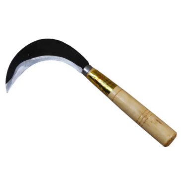

# Physics - 题目 2570

**ID**: 3980eefc34a74fdaafec1fa019a66ced
**年级**: Grade 8
**难度**: Easy
**题型**: Fill-in-the-blank

## 题目
在中学生劳动实践基地，同学们见到了挑水的扁担、收割麦子的镰刀等农具。​​​​​​​‌扁担中段制作得稍宽，是通过减小压强；如图所示是用来收割麦子的镰刀，镰刀的刀刃磨得非常锋利是为了压强；镰刀手柄处做得粗糙，是为了摩擦。（后两空选填“增大”或“减小”）

## 解答

1. 扁担中段制作得稍宽，是在压力一定时通过增大受力面积减小压强。
2. 镰刀的刀刃磨得非常锋利是为了减小受力面积，增大压强。
3. 镰刀手柄处做得粗糙，是通过增加接触面的粗糙程度来增大摩擦力。

## 知识点

**中文**:
  - 增大及减小压强的方法与应用
  - 增大或减小摩擦的方法

**English**:
  - Methods and Applications of Increasing/Decreasing Pressure
  - Methods to Increase or Decrease Friction

---
