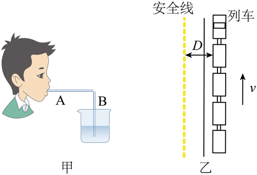

# Physics - 题目 1237

**ID**: 4b77ca68c4234e66bee17ba6bad1eedf
**年级**: Grade 8
**难度**: Easy
**题型**: Fill-in-the-blank

## 题目
吸管的一端做得比较尖，这是通过减小来增大压强。​​​​​​​‌如图甲所示，向A吸管内吹气，B吸管内的水面会上升，其原理是流体的流速越大，压强越。如图乙所示，已知普通列车站台安全线距离为D，根据所学知识，你认为高铁站台前的安全线距离应（选填“变大”、“变小”或“不变”）。

## 解答

1. 吸管的一端做得比较尖，这是在压力一定时，通过减小受力面积来增大压强。
2. 根据伯努利原理可知，在流体中，流速大的地方压强小，流速小的地方压强大。往A管中吹气，可以看到B管中的水面上升，原因是：往A管中吹气，B管上方空气的流速增大，压强减小，在管外大气压的作用下，B管内的水面上升。
3. 当列车急速驶过车站，警戒线区域内的空气流速会变大，由流体压强与流速的关系可知，警戒线以内的地方空气压强减小，而此时人外侧的空气流动速度慢，人外侧的空气压强大，会产生一个向内侧的压强差，将人推向列车，易出现危险；高铁列车速度大于普通列车，则向内侧的压强差会更大，所以应该增大站台上乘客与行驶的高铁之间安全距离。

## 知识点

**中文**:
  - 增大及减小压强的方法与应用
  - 流体压强与流速的关系

**English**:
  - Methods and Applications of Increasing/Decreasing Pressure
  - Relationship between Fluid Pressure and Flow Speed

---
