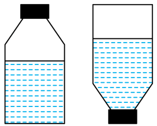

# Physics - 题目 818

**ID**: 4bcec9949bb94f12b42410dd27c2997a
**年级**: Grade 8
**难度**: Easy
**题型**: Fill-in-the-blank

## 题目
有一未装满水的瓶子如图，先正立在桌面上，然后再倒立在桌面上，则水对容器底的压强，水对容器底的压力。​​​​​​​‌（以上两空均选填“变大”“变小”或“不变”）

## 解答

1. 不论正立、还是倒立，瓶子中装的都是水，液体密度相同，由图可知，倒放时的水的深度变大，根据 $p=ρ{{}_{水}}gh$ 可知，倒放时对杯底的压强变大。
2. 正放时，瓶中的水柱是上下粗细一样的，水对容器底的压力等于水的重力，倒放时，瓶中的水柱上面粗、下面细，一部分水压的是瓶壁，所以瓶底受到的压力小于瓶中水的重力，所以，水对瓶底的压力变小。

## 知识点

**中文**:
  - 压力大小的比较
  - 液体压强计算公式的应用

**English**:
  - Comparing Magnitude of Pressure Force
  - Application of Liquid Pressure Formula

---
