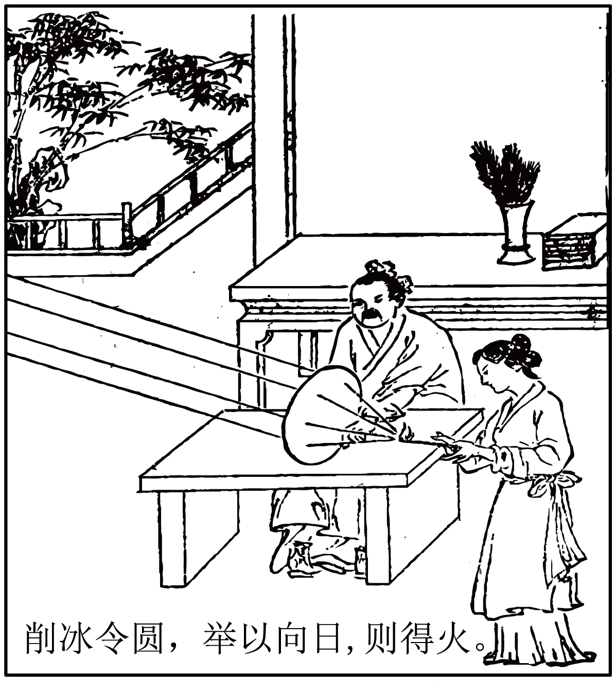

# Physics - 题目 604

**ID**: 588b4c77bba84a558dbc1c030d7928cf
**年级**: Grade 8
**难度**: Easy
**题型**: Fill-in-the-blank

## 题目
如图所示，晋代张华《博物志》记载：“削冰令圆，举以向日，以草承之，则得火”。​​​​​​​‌“削冰令圆”就是把冰块削成透镜，因为它对光线有作用。

## 解答

1. 凸透镜对光线有会聚的作用。要取火需要将光线会聚，所以应该将冰块制成凸透镜，凸透镜会把光线集中在焦点上时，所以当把艾放在焦点上时，会随着温度的升高达到燃点时即可燃烧。

## 知识点

**中文**:
  - 凸透镜的会聚作用
  - 辨别凸透镜和凹透镜

**English**:
  - Converging Effect of Convex Lenses
  - Distinguishing Convex and Concave Lenses

---
