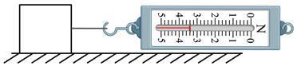

# Physics - 题目 2667

**ID**: 6f4a10f153b34b53a10ccf58a6c14a4c
**年级**: Grade 8
**难度**: Easy
**题型**: Fill-in-the-blank

## 题目
如图所示的测量工具，它是测量的仪器，此时它示数为牛。​​​​​​​‌

## 解答

1. [1]由图可知，该测量工具是弹簧测力计，可以测量力的大小。
2. [2]由图可知，弹簧测力计的分度值为0.2N，示数为3.4N。

## 知识点

**中文**:
  - 弹簧测力计原理及其使用

**English**:
  - Principle and Use of Spring Dynamometer

---
