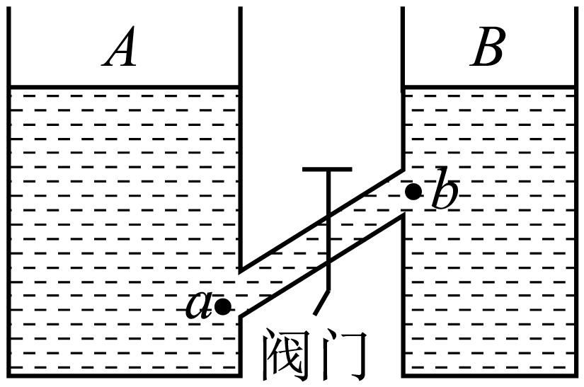

# Physics - 题目 684

**ID**: 722d23e988a64de894bfe637f2483d7f
**年级**: Grade 8
**难度**: Easy
**题型**: Fill-in-the-blank

## 题目
如图所示，A、B两个容器用一个带阀门的管子相连，两个容器中装有液面相平的同种液体，则a、b两处的压强大小关系为p_{a}（选填“>”“<”或“=”）p_{b}。​​​​​​​‌当打开阀门时，液体（选填“由A流向B”“由B流向A”或“不流动”）。

## 解答

1. 如图所示，两容器内液体密度相同， $h{{}_{{\rm{a}}}}>h{{}_{{\rm{b}}}}$ ，根据液体压强公式 $p=ρgh$ 可知 $p{{}_{{\rm{a}}}}>p{{}_{{\rm{b}}}}$ 。
2. 当打开阀门时，两容器上端开口，下端相连，形成了一个连通器，液体静止时两液面相平，故液体不会流动。

## 知识点

**中文**:
  - 液体压强计算公式的应用
  - 连通器原理

**English**:
  - Application of Liquid Pressure Formula
  - Principle of Communicating Vessels

---
