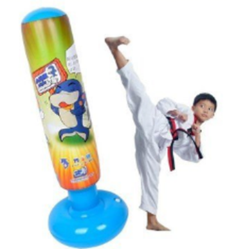

# Physics - 题目 2480

**ID**: 73b56eb259b9493cb22befb2bafcd3c4
**年级**: Grade 8
**难度**: Easy
**题型**: Fill-in-the-blank

## 题目
如图是不倒翁式拳击袋。​​​​​​​‌不倒翁想要不倒，它的重心应该偏（填 “高”或“低”），用相同的力击打拳击袋，使拳击袋发生最大程度倾斜应击打拳击袋的（填“上”或“下”）方，这说明力的作用效果与力的有关。

## 解答

1. 当物体重心引出的铅垂线在物体底部的支承面内，物体就不会倒下。不倒翁在摇晃的时候，它的重心越低，越稳定，越不容易倒下，所以不倒翁的重心应该偏低。
2. 根据杠杆平衡条件可知，当阻力和阻力臂一定时，动力臂越大，击打拳击袋的动力就越小，所以用相同的力击打拳击袋，使拳击袋发生最大程度倾斜应击打拳击袋的上方。
3. 相同的力击打的位置不同，拳击袋的倾斜程度就不同，说明力的作用效果与力的作用点有关。

## 知识点

**中文**:
  - 力的三要素
  - 重心

**English**:
  - Three Elements of Force
  - Center of Gravity

---
