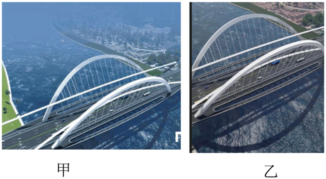

# Physics - 题目 2125

**ID**: 7d2a3a869e694c66b4397d9138cc419d
**年级**: Grade 8
**难度**: Easy
**题型**: Fill-in-the-blank

## 题目
如图所示是一架无人机携带的摄像机靠近桥梁时先后拍摄的两张照片（焦距不变）。​​​​​​​‌可以看到桥梁弧形拱顶在水中和地面上的阴影，它是光的（选填“直线传播”“反射”或“折射”）形成的，无人机从远处逐渐靠近桥梁，先拍摄的照片是（选填“甲”或“乙”），摄像机与（选填“照相机”“投影仪”或“放大镜”）相同成像原理相同。

## 解答

1. 桥梁弧形拱顶在水中和地面上的阴影是影子，影子是光经过不透明的物体时被遮挡形成的，它是光的直线传播形成的。
2. 摄像机利用物距大于2倍焦距，成倒立缩小的实像原理工作的，故摄像机与照相机相同成像原理相同。根据凸透镜成像规律，物距越大，像距越小，像越小，故无人机从远处逐渐靠近桥梁，物距变小，像距变大，像变大，先拍摄的照片是甲。

## 知识点

**中文**:
  - 光沿直线传播的应用
  - 凸透镜成像规律的应用

**English**:
  - Applications of Rectilinear Propagation
  - Applications of Convex Lens Imaging

---
