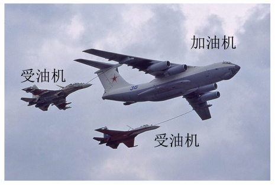

# Physics - 题目 1822

**ID**: 875af348288c4aa7a70fab1bbf5ebedc
**年级**: Grade 8
**难度**: Easy
**题型**: Fill-in-the-blank

## 题目
某次军演，加油机为受油机的空中加油，如果以加油机为参照物，受油机的运动状态是，以为参照物，它们都是运动的。​​​​​​​‌从而说明了运动和静止是的。

## 解答

1. 在军演中，加油机为受油机进行空中加油时，两者之间的相对位置是保持不变的。因此，如果以加油机为参照物，即观察受油机相对于加油机的位置变化，我们会发现受油机是静止的，也就是说，受油机的运动状态是静止的；如果换一个参照物，比如地面或者天空中的其他固定点，那么无论是加油机还是受油机，它们相对于这些参照物的位置都是在不断变化的。因此，以地面为参照物来看，加油机和受油机都是运动的；一个物体是运动还是静止，取决于我们选择的参照物。同一个物体，选择不同的参照物，其运动状态可能是不同的，说明了运动和静止是相对的。

## 知识点

**中文**:
  - 参照物及其选择
  - 运动和静止的相对性

**English**:
  - Reference Frame and Selection
  - Relativity of Motion and Rest

---
