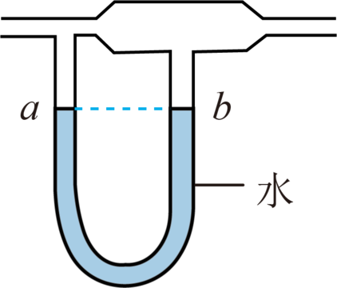

# Physics - 题目 252

**ID**: 88308940d0094b17a4f1c7125c816f99
**年级**: Grade 8
**难度**: Easy
**题型**: Fill-in-the-blank

## 题目
如图所示的实验装置，U形管中装有水，处于静止状态，a管中水面高度b管中水面高度；如果从右端往装置里用力吹气，a管中水面高度b管中水面高度。​​​​​​​‌（选填“大于”“等于”或“小于”）

## 解答

1. 根据连通器原理可知，当U形管中的水静止状态，a管中水面高度等于b管中水面高度；如果在右端往装置里用力吹气，由于b处比a处粗，导致b管上方气流速度小于a管上方的气流速度，根据伯努利原理可知，b管上气体压强大于a管上方气体压强，U形管中a管水面升高，a管中水面高度大于b管中水面高度。

## 知识点

**中文**:
  - 流体压强与流速的关系

**English**:
  - Relationship between Fluid Pressure and Flow Speed

---
