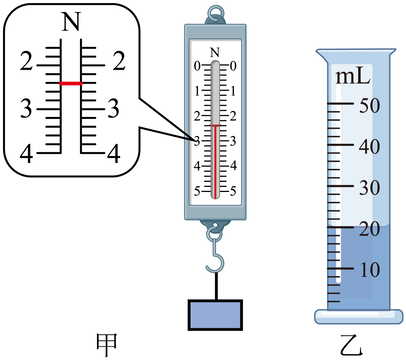

# Physics - 题目 1824

**ID**: 8939af332d804ebaacdd8ee8d6da7910
**年级**: Grade 8
**难度**: Easy
**题型**: Fill-in-the-blank

## 题目
回答下列问题：（1）如图甲所示，弹簧测力计的示数是N。​​​​​​​‌（2）如图乙所示，量筒中水的体积为mL。

## 解答

1. （1）由图甲可知，弹簧测力计的分度值为0.2N，示数为2.4N。
2. （2）由图乙可知，量筒的分度值为2mL，量筒中水的体积为20mL。

## 知识点

**中文**:
  - 弹簧测力计原理及其使用
  - 量筒(杯)的选择和使用

**English**:
  - Principle and Use of Spring Dynamometer
  - Selection and Use of Graduated Cylinder

---
