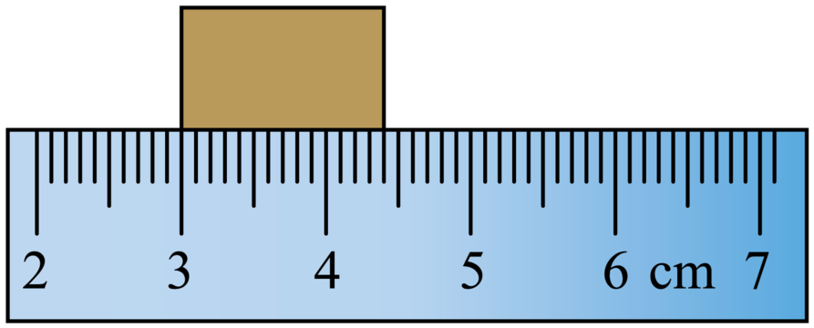

# Physics - 题目 2617

**ID**: 8cd32f7945b34680a2bbda9154c9af4a
**年级**: Grade 8
**难度**: Easy
**题型**: Fill-in-the-blank

## 题目
如图所示，物体的长度为cm。​​​​​​​‌

## 解答

1. 刻度尺的分度值为0.1cm，读数时要估读到分度值的下一位。物体左端与3.00cm对齐，物体的右端与4.40对齐，则长度为
2. $l=4.40cm-3.00cm=1.40cm$

## 知识点

**中文**:
  - 长度的测量

**English**:
  - Measurement of Length

---
