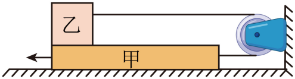

# Physics - 题目 2861

**ID**: 9588624a88bc4f6ab2fc4ae1f23e7084
**年级**: Grade 8
**难度**: Easy
**题型**: Fill-in-the-blank

## 题目
如图所示装置中，长木板甲重20N，物体乙重10N。​​​​​​​‌甲、乙之间用一根轻绳通过定滑轮相连，当水平方向的拉力F的大小为8N时，长木板甲恰能在光滑的水平桌面上以 $v{{}_{甲}}=3{\rm{m}}{\rm{/}}{\rm{s}}$ 向左做匀速直线运动。不计滑轮处摩擦，乙对甲的摩擦力为N，绳子拉物体乙的功率为W。

## 解答

1. 先分析甲的受力情况：由图可知，甲一共受到三个力：向左的拉力、乙对甲向右的摩擦力、绳子对甲向右的拉力，其中绳子对甲向右的拉力来自于乙和甲之间的摩擦力，所以这两个力大小是相等的，由于甲做匀速直线运动，所以这两个力之和等于8N，则长木板甲与物体乙之间摩擦力为4N，绳子对乙的拉力也是4N。因为是定滑轮，物体乙的速度和甲的移动速度相同，也是3m/s，所以绳子拉物体乙的功率为P=Fv=4N×3m/s=12W。

## 知识点

**中文**:
  - 二力平衡的条件及其应用
  - 功率的计算和估算

**English**:
  - Conditions and Applications of Two-Force Equilibrium
  - Calculation and Estimation of Power

---
