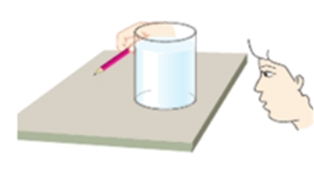

# Physics - 题目 105

**ID**: 977b88f26460406fbc7d335a8faaaed8
**年级**: Grade 8
**难度**: Easy
**题型**: Fill-in-the-blank

## 题目
找一个圆柱形的玻璃瓶，里面装满水。​​​​​​​‌把一支铅笔水平地靠近放在玻璃瓶的一侧，透过玻璃瓶，可以看到那支笔（选填“正立”或“倒立”）的虚像；把笔由靠近玻璃瓶的位置向远处稍稍移动，可以看到笔的像（选填“变长”或“变短”），继续向远处移动，可以看到“笔尖”反向像（选填“先变长后变短”或“先变短后变长”），所成像的为像（选填“实”或“虚”）。

## 解答

1. 圆柱形的玻璃瓶里面装满水，其相当于一个凸透像，把一支铅笔水平地靠近放在玻璃瓶的一侧，此时物距小于凸透镜的焦距，故透过玻璃瓶，可以看到那支笔正立（放大）的虚像。
2. 物体在一倍焦距以内时靠近焦点时，像会逐渐变大，故把笔由靠近玻璃瓶的位置向远处稍稍移动，可以看到笔的像变长。
3. 当物体在一倍焦距以外时，成倒立的实像，故可以看到铅笔尖突然改变方向。远离焦点时，像会逐渐变小，即继续向远处移动，可以看到“笔尖”反向像先变长后变短，所成的像为实像。

## 知识点

**中文**:
  - 凸透镜成像规律的应用

**English**:
  - Applications of Convex Lens Imaging

---
