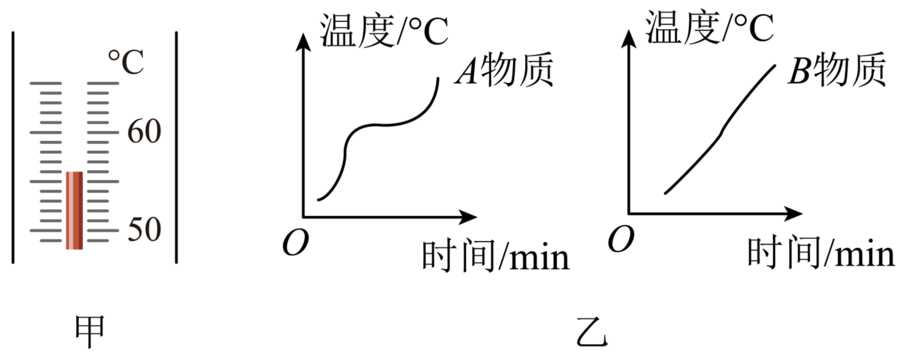

# Physics - 题目 2644

**ID**: 9ba00203358b4c4988597ccd57d471c8
**年级**: Grade 8
**难度**: Easy
**题型**: Fill-in-the-blank

## 题目
在探究固体熔化规律的实验中，某时刻用摄氏温度计测得的温度如甲图所示，则读数为℃；乙图为A、B两种物质熔化时温度随时间变化的图像，可判断（选填“A”或“B”）物质为非晶体。​​​​​​​‌

## 解答

1. 如图甲所示，温度计的分度值为1℃，读数为56℃。
2. 如图乙所示，A物质有固定的熔点，是晶体，B物质没有固定的熔点，是非晶体。

## 知识点

**中文**:
  - 晶体和非晶体的区别
  - 温度计的使用与读数
  - 熔化的温度—时间图像

**English**:
  - Difference between Crystals and Amorphous Solids
  - Using and Reading Thermometers
  - Temperature-Time Graph of Melting

---
