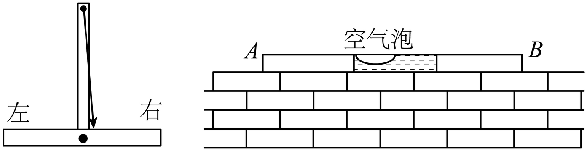

# Physics - 题目 1715

**ID**: 9bbee3e66e6e4a23a97c853bafe52309
**年级**: Grade 8
**难度**: Easy
**题型**: Fill-in-the-blank

## 题目
建筑工人常用铅垂线来检查墙壁是否竖直，这是利用了重力的方向竖直向下的性质，如图左所示，如图所示为水平仪放置于某桌面上时的情形，则该桌面左面（“高”或”低”）。​​​​​​​‌在砌房子时如图所示，水平仪来检查所砌的墙面是否水平，当液体中空气泡居中表示墙面水平，若空气泡在A端，则表示A端的墙面（“高”或“低”）。

## 解答

1. 图中左侧的水平仪，重垂线偏向右侧，说明右侧的桌面偏低，左侧桌面偏高。
2. 图示右侧的水平仪液体中的空气泡在A端，说明A端墙面高，因为液体在重力的作用下向低处流动，所以气泡往高处移动。

## 知识点

**中文**:
  - 重力的方向

**English**:
  - Direction of Gravity

---
