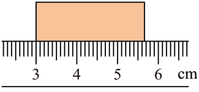

# Physics - 题目 2304

**ID**: b51c50216cca47379c223bcc62ec8604
**年级**: Grade 8
**难度**: Easy
**题型**: Fill-in-the-blank

## 题目
用如图所示的刻度尺测量物体的长度，这把刻度尺的分度值是，所测物体的长度是cm。​​​​​​​‌

## 解答

1. 图示刻度尺1 cm分为10个小刻度，故最小刻度值为1mm。
2. 始端刻度值为3.00 cm，末端刻度值为5.64 cm，物体长度为
3. ${{5}}{{.}}{{6}}{{4}}{\rm{\;}}{\rm{c}}{\rm{m}}-{{3}}{{.}}{{0}}{{0}}{\rm{\;}}{\rm{c}}{\rm{m}}=2.64{\rm{c}}{\rm{m}}$

## 知识点

**中文**:
  - 长度的测量

**English**:
  - Measurement of Length

---
