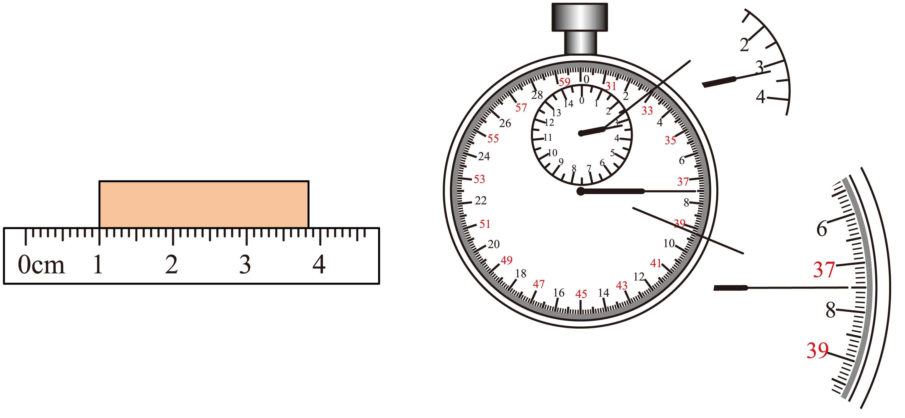

# Physics - 题目 867

**ID**: bdb2f8a8ebdc45a89e672938e6fdbeac
**年级**: Grade 8
**难度**: Easy
**题型**: Fill-in-the-blank

## 题目
如图所示，刻度尺的分度值是mm，木块的长度为cm。​​​​​​​‌在使用秒表测量时间时，指针指示位置如右图所示，该读数是s。

## 解答

1. 刻度尺上1cm之间有10个小格，所以一个小格代表的长度是0.1cm=1mm，即此刻度尺的分度值为1mm。木块左侧与1.00cm对齐，右侧与3.85cm刻度对齐，所以木块的长度为 $L={{3}}{{.}}{{8}}{{5}}{\rm{c}}{\rm{m}}{{-}}{{1}}{{.}}{{0}}{{0}}{\rm{c}}{\rm{m}}{\rm{=}}{{2}}{{.}}{{8}}{{5}}{\rm{c}}{\rm{m}}$ ，在秒表的中间表盘上，1min中间有两个小格，所以一个小格代表0.5min，分针指在“3”和“4”之间，靠近“3”，所以分针指示的时间为3min；在停表的大表盘上，1s之间有10个小格，所以一个小格代表0.1s，由于小盘没有过中线，秒针读小于30的数，指针在7.5s处，即秒表的读数为
2. $3{\rm{m}}{\rm{i}}{\rm{n}}{{7}}{{.}}{{5}}{\rm{s}}{\rm{=}}{{2}}{{1}}{{7}}{{.}}{{5}}{\rm{s}}$

## 知识点

**中文**:
  - 时间的测量
  - 长度的测量

**English**:
  - Measurement of Time
  - Measurement of Length

---
