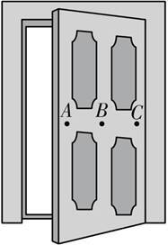

# Physics - 题目 2053

**ID**: cd3799fa80d94d9fadb52ccc1d42b52e
**年级**: Grade 8
**难度**: Easy
**题型**: Fill-in-the-blank

## 题目
如图所示，分别在A、B、C处用同样大小的力推门，感受到手推门的难易程度不同，这说明力产生的作用效果与力的（选填“大小”、“方向”或“作用点”）有关。​​​​​​​‌

## 解答

1. [1]在A、B、C处用同样大小的力推门，感受到手推门的难易程度不同，这说明力产生的作用效果与力的作用点有关。

## 知识点

**中文**:
  - 力的三要素

**English**:
  - Three Elements of Force

---
