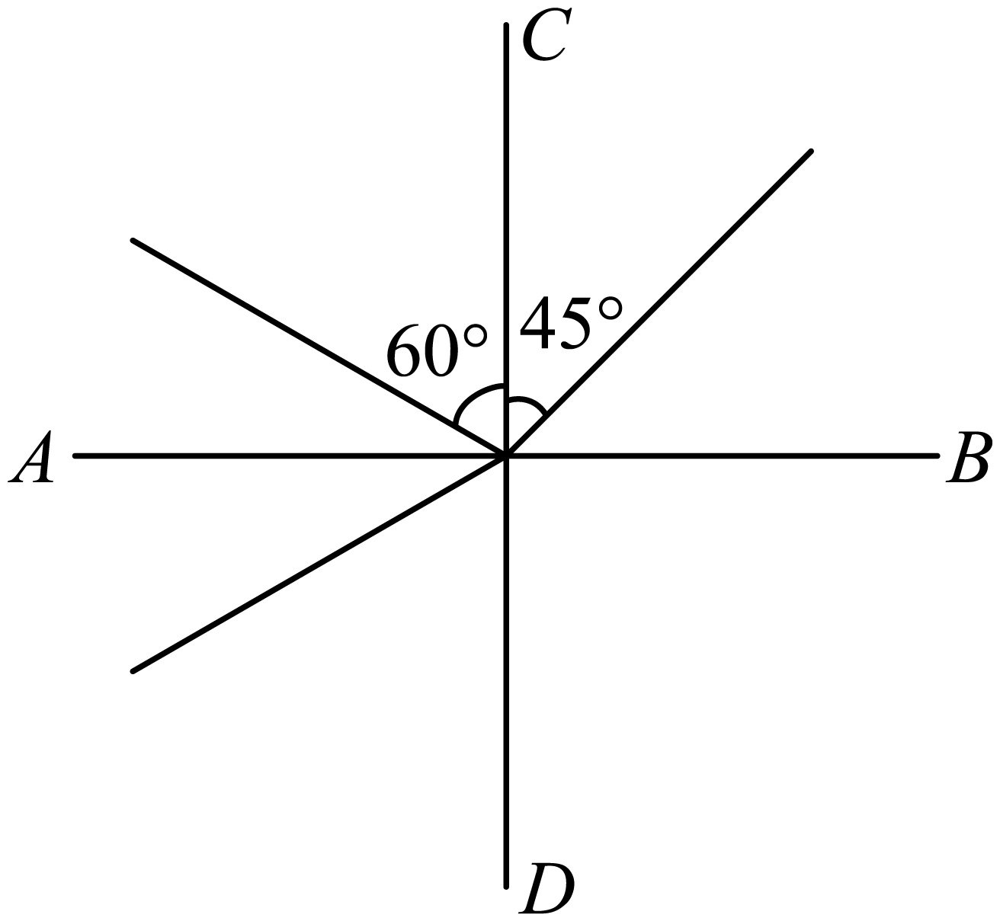

# Physics - 题目 643

**ID**: d5ac5352991f4fa39efeea19889625fe
**年级**: Grade 8
**难度**: Easy
**题型**: Fill-in-the-blank

## 题目
完成下列各题。​​​​​​​‌（1）雨后晴朗的夜晚，为了不踩到地上的积水，人们根据生活经验判断：迎着月光走，地上发（选填“亮”或“暗”）的是水。这是因为月光照在水面上发生（选填“镜面”或“漫”）反射的缘。（2）如图所示，光在玻璃和空气界面同时发生反射和折射现象，由图可知，入射角大小为，界面（选填“AB上”，“AB下”，“CD左”或“CD右”）侧是空气。

## 解答

1. （1）平静的水面比较光滑，能发生镜面反射，地面凹凸不平，发生漫反射，迎着月光走，月光经过水面发生镜面反射，进入人眼的反射光线多，人感觉水面亮。
2. （2）由图可知AB上和AB下的光线关于AB对称，可知AB是法线，而CD是界面，根据光的折射定律，CD右的光线为折射光线，AB下的光线为入射光线；根据光的反射定律，AB上、CD左侧的光线为反射光线，反射角等于入射角为 $90{}\degree -60{}\degree {\rm{=}}30{}\degree $ ，由图可知，折射角为 $90{}\degree -45{}\degree {\rm{=}}45{}\degree $ ，折射角大于入射角，光从玻璃斜射入空气，则CD右侧是空气。

## 知识点

**中文**:
  - 光的反射定律及其应用
  - 光的折射规律及其应用

**English**:
  - Law of Reflection and Applications
  - Law of Refraction and Applications

---
