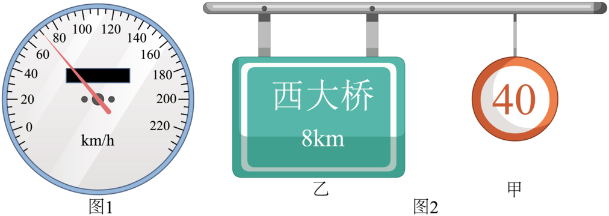

# Physics - 题目 1268

**ID**: dd94cb360bfa47e08c503618e4c33ca4
**年级**: Grade 8
**难度**: Easy
**题型**: Fill-in-the-blank

## 题目
如图是汽车速度计，此时汽车的速度是km/h；​​​​​​​‌如图是交通标志，由标志可知汽车从这两个标志牌到西大桥最快要min．以交通标志牌为参照物，此时汽车是的．

## 解答

1. 由如图所示汽车速度计可知，此时汽车的速度是70km/h；
2. 由如图甲所示交通标志可知，该路段限速40km/h；由如图乙所示交通标志牌可知，此处距西大桥的距离是8km；根据v= $\frac {s}{t}$ 可得：汽车从这两个标志牌到西大桥最快要t= $\frac {s}{v}$ = $\frac {8km}{40km/h}$ =0.2h=12min；以交通标志牌为参照物，汽车与交通标志牌之间的位置发生了变化，所以汽车是运动的．

## 知识点

**中文**:
  - 运动和静止的相对性
  - 速度公式及其应用

**English**:
  - Relativity of Motion and Rest
  - Velocity Formula and Applications

---
