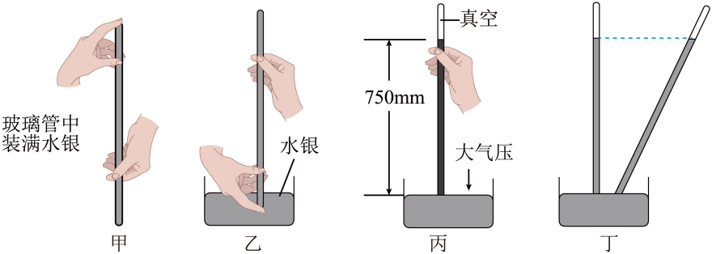

# Physics - 题目 2532

**ID**: e291508fdea64045ad14efaf764ae0c9
**年级**: Grade 8
**难度**: Easy
**题型**: Fill-in-the-blank

## 题目
如图所示，将长约1m、一端封闭的玻璃管灌油水银，用手指将管口堵住，倒插在水银槽中，放开手指，管内水银面下降到一定高度就不再下降。​​​​​​​‌当地此时大气压的数值就等于mm水银柱所产生的压强：实验中选用水银而不是水来做实验，这是利用水银的较大的特性：在实验过程中，若像图丁中一样将玻璃管倾斜，水银柱的竖直高度将。

## 解答

1. 托里拆利实验中，一开始在水银管内灌满水银，这样可以将管内空气全部排出，保证管内水银上方为真空，玻璃管内水银柱不会落下是靠大气压支持，由图乙可知，当地此时大气压的数值就等于750mm水银柱所产生的压强。
2. 根据p=ρgh得，，在p一定时，密度越小，深度越大，为了操作方便，做托里拆利实验时应选用密度大的水银。
3. 实验时水银柱的高度与玻璃管的粗细、长短、倾斜，以及水银槽中水银的多少无关。在实验过程中，若像图丁中一样将玻璃管倾斜，水银柱的竖直高度将不变。

## 知识点

**中文**:
  - 大气压强的测量及标准大气压

**English**:
  - Measurement of Atmospheric Pressure & Standard ATM

---
