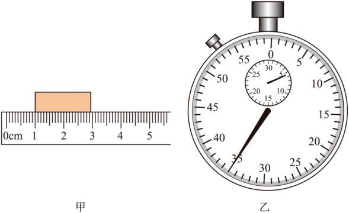

# Physics - 题目 2325

**ID**: e9164eac619c4d07b7b529b44da567b3
**年级**: Grade 8
**难度**: Easy
**题型**: Fill-in-the-blank

## 题目
如图所示，如图甲中木块的长度为cm，如图乙中秒表的读数为s。​​​​​​​‌

## 解答

1. [1]由图甲知：刻度尺上1cm之间有10个小格，所以一个小格代表1mm，即刻度尺的分度值为1mm；木块左侧与1.00cm对齐，右侧与2.95cm对齐，所以木块的长度为
2. $L=2.95{\rm{c}}{\rm{m}}-1.00{\rm{c}}{\rm{m}}=1.95{\rm{c}}{\rm{m}}$
3. [2]由图乙知，在秒表的中间表盘上，1min中间有一个小格，所以一个小格代表1min，指针在5min和6min之间，显示的是 $5{\rm{m}}{\rm{i}}{\rm{n}}=300{\rm{s}}$ ；在秒表的大表盘上，一个小格代表1s，指针在35s处，所以秒针指示的时间为35s，即秒表的读数为
4. $300{\rm{s}}+35{\rm{s}}=335{\rm{s}}$

## 知识点

**中文**:
  - 刻度尺的使用
  - 时间的测量

**English**:
  - Use of Ruler/Scale
  - Measurement of Time

---
