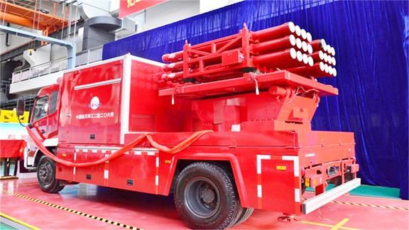

# Physics - 题目 781

**ID**: e931abf952924c08b204519bb74953d1
**年级**: Grade 8
**难度**: Easy
**题型**: Fill-in-the-blank

## 题目
为解决高楼灭火难题。​​​​​​​‌军工转民用“导弹灭火”技术实验成功，如图，发射架上有三只眼：“可见光”“红外线”和“激光”，当高楼内有烟雾火源不明时，可用（可见光/红外线/激光）发现火源，可用（可见光/红外线/激光）精确测量火源距离。如果探测器从发射到接收到返回信号的时间为 $4\times 10{^{-7}}{\rm{s}}$ ，那么探测器距离火源为m（激光光速为 $3\times 10{^{8}}{\rm{m}}{\rm{/}}{\rm{s}}$ ）。

## 解答

1. 自然界中一切物体都向外辐射红外线，而且温度越高，辐射的红外线越强，可用红外线发现火源。
2. 激光测距的原理：激光测距仪向目标发射激光脉冲束，接受返回来的激光束，测出激光往返所用的时间，就可以算出所测的距离。
3. 如果探测器从发射到接收到返回信号的时间为 $4\times 10{^{-7}}{\rm{s}}$ ，那么探测器距离火源为 $s=vt=3\times 10{^{8}}{\rm{m}}{\rm{/}}{\rm{s}}\times \frac {1}{2}\times 4\times 10{^{-7}}{\rm{s}}={\rm{6}}{\rm{0}}{\rm{m}}$

## 知识点

**中文**:
  - 红外线的特点及应用
  - 速度公式及其应用

**English**:
  - Characteristics and Applications of Infrared
  - Velocity Formula and Applications

---
