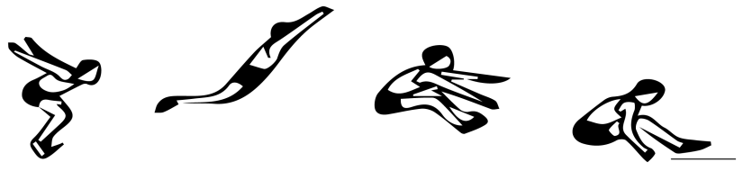

# Physics - 题目 1560

**ID**: f0dcfbaf0fd74468921a0cc0e7ec2978
**年级**: Grade 8
**难度**: Easy
**题型**: Fill-in-the-blank

## 题目
如图所示，立定跳远主要分四个部分：蹬地起跳，空中滑翔，下肢前伸，双脚落地。​​​​​​​‌人起跳时用力向下蹬地，身体腾空而起这是因为物体间力的作用是；腾空后人会在空中滑翔一段距离，这是因为人具有；人落到沙坑中会留下痕迹，说明力可以改变物体的；每一次跳远人总是落到地面，是因为受到的作用。

## 解答

1. 人起跳时用力向下蹬地，同时人也受到地对其的推力，所以人身体腾空而起，是因为物体间力的作用是相互的。
2. 腾空后人不再受到地面的推力，而是由于惯性，仍保持原来的运动状态，所以人会在空中滑翔一段距离。
3. 力可以改变物体的形状即使物体发生形变。落到沙坑中会留下痕迹，说明力可以改变物体的形状。
4. 因为受到竖直向下的重力的作用，所以人最终落到地面。

## 知识点

**中文**:
  - 力的作用效果
  - 力的作用是相互的
  - 重力的方向
  - 生活中的惯性现象

**English**:
  - Effects of Force
  - Interaction of Forces
  - Direction of Gravity
  - Inertia Phenomena in Daily Life

---
