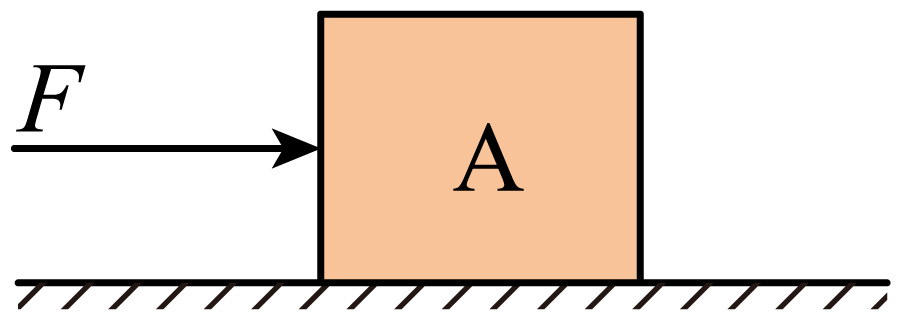

# Physics - 题目 1174

**ID**: f71a52ecd04b48cea8f22d0f5087e58a
**年级**: Grade 8
**难度**: Easy
**题型**: Fill-in-the-blank

## 题目
如图所示，用大小为5N的水平推力F，推动物体A向右做匀速直线运动，运动一段时间后撤掉F的那一瞬间，物体A受到的合力为N，方向为。​​​​​​​‌

## 解答

1. 当物体A在水平向右的力F=5N的作用下，向右做匀速直线运动时，受平衡力，合力为0，水平方向上所受到推力和摩擦力是一对平衡力，此时F=f=5N
2. 当运动一段时间后撤掉F的那一瞬间，不再对物体A施加推力，物体A由于惯性将继续向右运动，此时仍然是物体A在水平桌面上运动而产生的摩擦，即在压力不变，接触面的粗糙程度不变的情况下，所受摩擦力也不变仍为5N，由于摩擦力的方向与物体的运动趋势方向相反，故该物体所受的摩擦力水平向左，竖直方向上仍是一对平衡力，故此时物体A受到的合力等于它受到的摩擦力，大小为5N，方向水平向左。

## 知识点

**中文**:
  - 力的合成与应用

**English**:
  - Composition of Forces and Applications

---
