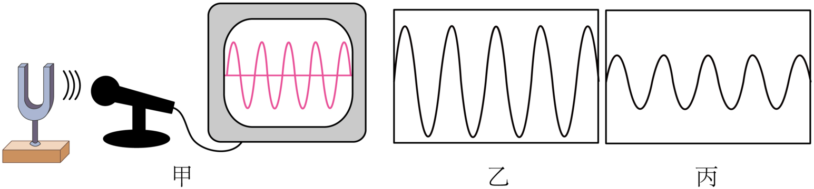

# Physics - 题目 1277

**ID**: fc02b8df624549abb022b9eb647bc088
**年级**: Grade 8
**难度**: Easy
**题型**: Fill-in-the-blank

## 题目
如图甲，把音叉发出的声音信号输入示波器，观察示波器屏幕上的图象。​​​​​​​‌小明发现，刚开始的时候，图象如图乙，过了几秒钟，图象变成如图丙。由图象可知，这段时间内，声音的和没有改变，声音的改变了（以上三空格选填“响度”“音调”或“音色”）。该音叉 $1{\rm \min }$ 内振动了1500次，则音叉发出的声音频率为${\rm{H}}{\rm{z}}$ ，从物理学角度分析，该音叉发出的声音为（选填“乐音”或“噪音”）。

## 解答

1. 声波的形状没有变，发声材料不变，音色不变。
2. 相同的时间内，波的个数相同，波的密集程度不变，振动频率不变，音调不变。
3. 波的高度发生了变化，振动的幅度发生了变化，响度发生了变化。
4. 该音叉 $1{\rm \min }$ 内振动了1500次，则音叉发出的声音频率为 $f=\frac {1500次}{60{\rm{s}}}{\rm{=}}25{\rm{H}}{\rm{z}}$
5. 从波的形状可以看出，是有规则的振动，故从物理学的角度来说，音叉的振动是乐音。

## 知识点

**中文**:
  - 区分音调、响度与音色
  - 噪声及其来源

**English**:
  - Distinguishing Pitch, Loudness, and Timbre
  - Noise and Its Sources

---
