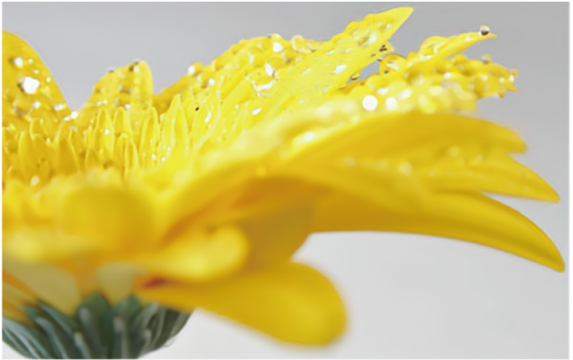

# Physics - 题目 2363

**ID**: fdafb0ca885848588cb0039a0516b241
**年级**: Grade 8
**难度**: Easy
**题型**: Fill-in-the-blank

## 题目
如图所示，清晨菊花瓣上挂着晶莹的露珠，露珠是空气中的水蒸气形成的，太阳出来后露珠因而消失不见了（两空均填写物态变化名称）。​​​​​​​‌

## 解答

1. 物质由气态变为液态的过程叫液化，露珠是水蒸气遇冷液化形成的小水滴。
2. 太阳出来后，温度升高，露珠会由液态变成气态，发生汽化现象，露珠消失不见了。

## 知识点

**中文**:
  - 汽化及汽化吸热的特点
  - 液化及液化放热的特点

**English**:
  - Vaporization and Heat Absorption
  - Liquefaction and Heat Release

---
