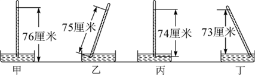

# Physics - 题目 503

**ID**: fdb9c5b6ba104ec88b01439084d04cef
**年级**: Grade 8
**难度**: Easy
**题型**: Fill-in-the-blank

## 题目
如图所示，四位同学在同一地点用水银做托里拆利实验，当时的大气值应为cm汞柱。​​​​​​​‌

## 解答

1. 托里拆利实验中测量汞柱高度时应当测量汞柱上液面与容器水银液面的竖直高度差，只有丁同学的测量符合要求，故大气压值为73cm汞柱。

## 知识点

**中文**:
  - 大气压强的测量及标准大气压

**English**:
  - Measurement of Atmospheric Pressure & Standard ATM

---
