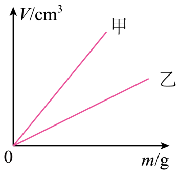

# Physics - 题目 692

**ID**: 003920bdd69b4f27a654beb2dbc5b5ee
**年级**: Grade 8
**难度**: Easy
**题型**: Multiple-choice

## 题目
某实验小组分别用托盘天平和量筒测出两种物质的质量和体积，根据测量数据作出V-m图像如图所示，关于它们的密度说法正确的是（      ）​​​​​​​‌

## 解答

1. AB．根据图像可知，在质量相等时，甲的体积大于乙的体积，由 $ρ=\frac {m}{V}$ 可知， $ρ{{}_{甲}}{\rm{<}}ρ{{}_{乙}}$ ，故AB错误；
2. C．由于 $ρ{{}_{甲}}{\rm{<}}ρ{{}_{乙}}$ ，若甲、乙物质制成质量相等的实心小球，由 $ρ=\frac {m}{V}$ 可知，乙球的体积较小，故C错误；
3. D．由于 $ρ{{}_{甲}}{\rm{<}}ρ{{}_{乙}}$ ，若甲、乙物质制成体积相等的实心小球，由 $ρ=\frac {m}{V}$ 可知，乙小球的质量较大，故D正确。

## 知识点

**中文**:
  - 密度公式的应用

**English**:
  - Application of Density Formula

---
