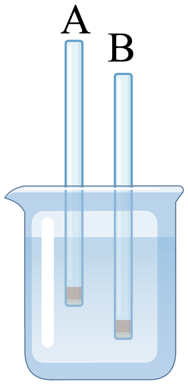

# Physics - 题目 532

**ID**: 131d0e0f319c400db92e67c55219fa64
**年级**: Grade 8
**难度**: Easy
**题型**: Multiple-choice

## 题目
两同学分别在底端封闭的两支相同吸管中装入不同质量的细沙，制成了A、B两支密度计，放入同一个盛有水的烧杯中，静止后如图所示。​​​​​​​‌下列说法正确的是（      ）

## 解答

1. A．根据阿基米德原理F_{浮}=ρ_{液}gV_{排}_{，}A、B均漂浮在水中，故液体密度相同。由图可知V_{B}_{排}>V_{A}_{排}_{，}可得F_{B}_{浮}>F_{A}_{浮}_{，}故A正确；
2. B．密度计处于漂浮状态，浮力和重力的关系为F_{浮}=G_{计}_{，}因为F_{B}_{浮}>F_{A}_{浮}_{，}所以，G_{B}>G_{A}
3. 故B错误；
4. C．A、B浸没的深度关系为h_{A}<h_{B}_{，}根据液体压强公式p=ρgh，可得p_{A}<p_{B}_{，}故C错误；
5. D．密度计是用来测量液体密度的仪器，密度计漂浮时，在液面处的刻度就是所测液体的密度，A、B均为密度计，漂浮在水上，所以两密度计在水面处的刻度都是水的密度，故D错误。

## 知识点

**中文**:
  - 物体的浮沉条件及其应用
  - 阿基米德原理的应用

**English**:
  - Floating/Sinking Conditions and Applications
  - Applications of Archimedes' Principle

---
