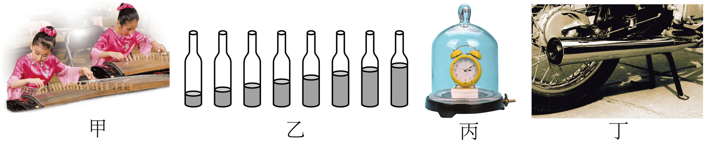

# Physics - 题目 239

**ID**: 22bc925367954a8ab9effd48ff0e9c7f
**年级**: Grade 8
**难度**: Easy
**题型**: Multiple-choice

## 题目
如图所示的现象中，下列分析不正确的是（      ）​​​​​​​‌

## 解答

1. A．弹奏古筝时，手在不同位置按弦，目的是为了改变发出声音的音调，故A错误，符合题意；
2. B．声音是由物体振动产生的，对着瓶口吹气，发出的声音是由瓶中空气柱的振动产生的，故B正确，不符合题意；
3. C．声音的传播需要介质，抽掉玻璃罩中的空气，听到闹钟铃声的音量会逐渐变小，故C正确，不符合题意；
4. D．摩托车上装有消声器，是为了防止噪声产生，是在声源处阻断噪声的传播，故D正确，不符合题意。

## 知识点

**中文**:
  - 区分音调、响度与音色
  - 声音的产生和声源
  - 防治噪声的途径
  - 探究真空不能传声

**English**:
  - Distinguishing Pitch, Loudness, and Timbre
  - Sound Production and Sound Sources
  - Methods of Noise Control
  - Investigation: Vacuum Cannot Transmit Sound

---
