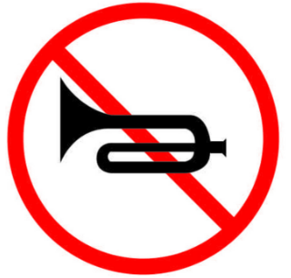

# Physics - 题目 53

**ID**: 2571f7ea96374e27b6da5d4d757a150c
**年级**: Grade 8
**难度**: Easy
**题型**: Multiple-choice

## 题目
在下列措施中，与如图所示的标志控制噪声方法相同的是（      ）​​​​​​​‌

## 解答

1. 禁止鸣笛是在声源处减弱噪声。
2. A．工人戴上防噪声耳罩，是在人耳处减弱噪声，故A不符合题意；
3. B．在摩托车上安装消声器，是在声源处减弱噪声，故B符合题意；
4. C．上课时关闭教室的门窗，是在传播途径中减弱噪声，故C不符合题意；
5. D．在道路旁设置隔声板，是在传播途径中减弱噪声，故D不符合题意。

## 知识点

**中文**:
  - 防治噪声的途径

**English**:
  - Methods of Noise Control

---
