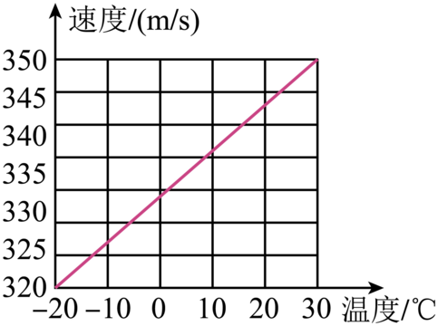

# Physics - 题目 107

**ID**: 3227742359114bcc8747b46ab7c086e1
**年级**: Grade 8
**难度**: Easy
**题型**: Multiple-choice

## 题目
声音在干燥空气中的速度随温度的变化而变化，如图是声速大小跟空气温度的关系图。​​​​​​​‌从图中可以获得的信息有（      ）

## 解答

1. A．图像体现的是声音在干燥空气中的速度随温度的变化而变化，没有体现声音在真空中的速度，故A不符合题意；
2. B．由图像知道，声速大小跟空气温度成一次函数，即说明声音在空气中的传播速度与温度有关，故B不符合题意；
3. C．由图像知道，声速大小跟空气温度成一次函数，即空气温度越高，声音的传播速度越大，故C不符合题意；
4. D．由图像知道，当空气温度为 $30{}^\circ {\rm{C}}$ 时，对应的纵坐标，即声音的传播速度接近350m/s，故D符合题意。
5. 故选D。

## 知识点

**中文**:
  - 声速

**English**:
  - Speed of Sound

---
