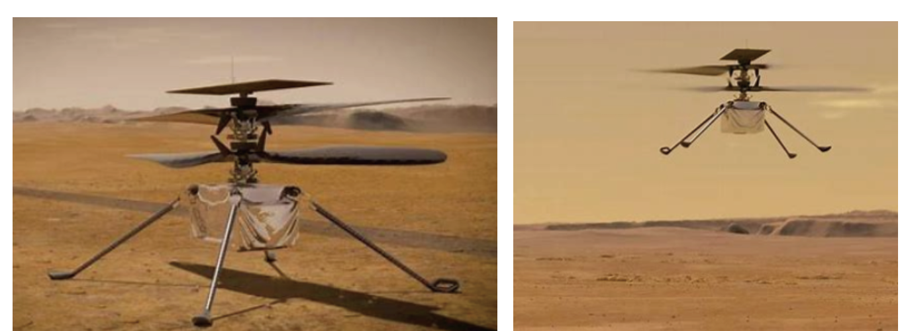

# Physics - 题目 302

**ID**: 4bb0a66495f84fdfa4e3744b5ce60450
**年级**: Grade 8
**难度**: Easy
**题型**: Multiple-choice

## 题目
小明从科技杂志上看到一种能在火星上飞行的直升机——机智号，如图所示。​​​​​​​‌杂志上介绍：机智号的质量为1.8kg，每只支脚与地面的接触面积是 $2{\rm{c}}{\rm{m}}{^{2}}$ ，火星对表面附近的物体也有类似地球上“重力”的作用，其g值约为3.7N/kg。机智号在地球上旋翼的转速是每分钟300转，到了火星上可达每分钟2400转。通过文中信息，小明对火星和机智号有以下认识，其中认识错误的是（      ）

## 解答

1. A．机智号能在火星上飞行，在地球上旋翼的转速是每分钟300转，到了火星上可达每分钟2400转，机智号靠旋翼上下方气体流速差获得升力，因此火星表面有气体存在，故A正确，不符合题意；
2. B．机智号的质量为 1.8 kg，物体的质量不随位置、物态，形状、温度而改变，因此机智号无论是在地球上还是火星上，质量是不变的，故B正确，不符合题意；
3. C．机智号在地球上所受重力为 $G=mg=1.8{\rm{k}}{\rm{g}}\times 10{\rm{N}}/{\rm{k}}{\rm{g}}=18{\rm{N}}$
4. 机智号在火星上所受重力为 $G^{′}=mg^{′}=1.8{\rm{k}}{\rm{g}}\times 3.7{\rm{N}}/{\rm{k}}{\rm{g}}=6.66{\rm{N}}$
5. 机智号在火星上受到“重力”要比在地球上受到的重力小，故C正确，不符合题意；
6. D．每只支脚与地面的接触面积为 2 cm^{2}，共 4 只支脚，总接触面积 $S=4\times 2{\rm{c}}{\rm{m}}{^{{{2}}}}=8{\rm{c}}{\rm{m}}{^{2}}=8\times 10{^{-4}}{\rm{m}}{^{{{2}}}}$
7. 静止在火星表面的机智号对地面产生的压强为 $p=\frac {F}{S}=\frac {G^{′}}{S}{\rm{=}}\frac {6.66{\rm{N}}}{8\times 10{^{-4}}{\rm{m}}{^{{{2}}}}}\approx 8.3\times 10{^{3}}{\rm{P}}{\rm{a}}$
8. 故 D 错误，符合题意。

## 知识点

**中文**:
  - 质量及其特性
  - 重力的概念

**English**:
  - Mass and its Characteristics
  - Concept of Gravity

---
