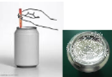

# Physics - 题目 413

**ID**: 5c24c8b5ff2842f1bd7fa628cc2b48e6
**年级**: Grade 8
**难度**: Easy
**题型**: Multiple-choice

## 题目
如图，在一个标准大气压下，某同学将冰块放人空易拉罐中并加人适量的盐，用筷子搅拌大约半分钟，测得易拉罐中冰与盐水混合物的温度低于0℃，实验时易拉罐的底部有白霜生成．对于这一实验和现象的分析，正确的是（      ）​​​​​​​‌

## 解答

1. 往冰上撒盐，使冰中参入杂质，降低冰的熔点，使冰熔化；同时空气中的水蒸气遇冷直接凝华成小冰晶附在底部形成霜．
2. 故选A．

## 知识点

**中文**:
  - 熔点和凝固点
  - 生活中的凝华现象

**English**:
  - Melting Point and Freezing Point
  - Deposition Phenomena in Life

---
