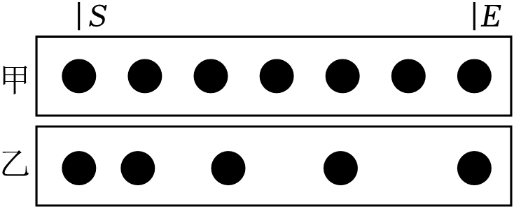

# Physics - 题目 521

**ID**: 6dd73ef26b344e8881ffbe9b161c3861
**年级**: Grade 8
**难度**: Easy
**题型**: Multiple-choice

## 题目
“频闪摄影”是研究物体运动时常用的一种实验方法。​​​​​​​‌摄影在暗室中进行，闪光灯每隔一定的时间闪亮一次，底片就记录下物体此时的位置。如图是甲、乙两个网球从S点向E点运动时的频闪照片，则关于两球从S点向E点运动全过程中，由照片可知，下列说法错误的是（      ）

## 解答

1. AD．闪光灯每隔一定的时间闪亮一次，即摄影的时间间隔是相同的；由图知，甲球所用时间为6个间隔时间，乙球所用时间为4个间隔时间，所以照片中甲球与乙球的运动时间之比为6：4＝3：2，故D错误；
2. 甲、乙运动的路程相同，根据 $v=\frac {s}{t}$ 可知，在路程一定时，照片中甲球与乙球的平均速度与时间成反比，平均速度之比为2：3，故A正确；
3. B．由图知，甲球在相等时间内通过的路程基本相同，所以甲球运动的速度基本保持不变，故B正确；
4. C．而乙球在相等时间内通过的路程越来越长，即乙球的运动速度越来越大，故C正确。

## 知识点

**中文**:
  - 速度公式及其应用

**English**:
  - Velocity Formula and Applications

---
