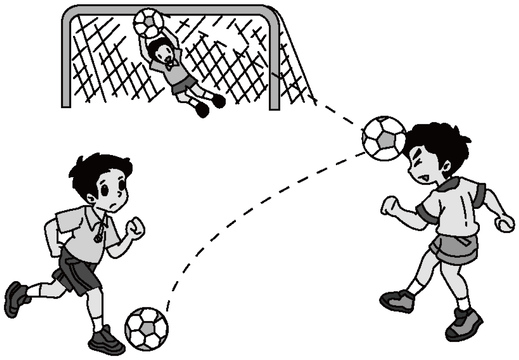

# Physics - 题目 226

**ID**: 7e40def14bd0467893f9e1a3e5241760
**年级**: Grade 8
**难度**: Easy
**题型**: Multiple-choice

## 题目
如图是足球运动员踢足球时的情景，下列说法不正确的是（      ）​​​​​​​‌

## 解答

1. A．踢球时，脚给球施加力的同时脚也会感到疼，说明球也会给脚一个力，可得物体间力的作用是相互的，故A正确，不符合题意；
2. B．足球在空中飞行过程中，受到重力和空气阻力作用，足球的运动方向和速度大小均变化，即运动状态一定发生改变，故B正确，不符合题意；
3. C． 脚踢球瞬间，球发生弹性形变，从而产生弹力，故C正确，不符合题意；
4. D．空中飞行的足球，若它所受的力全部消失，根据牛顿一定律，则它将沿原来的运动方向做匀速直线运动，故D错误，符合题意。

## 知识点

**中文**:
  - 力的作用是相互的
  - 牛顿第一定律的理解与应用
  - 弹力

**English**:
  - Interaction of Forces
  - Understanding and Application of Newton's First Law
  - Elastic Force

---
